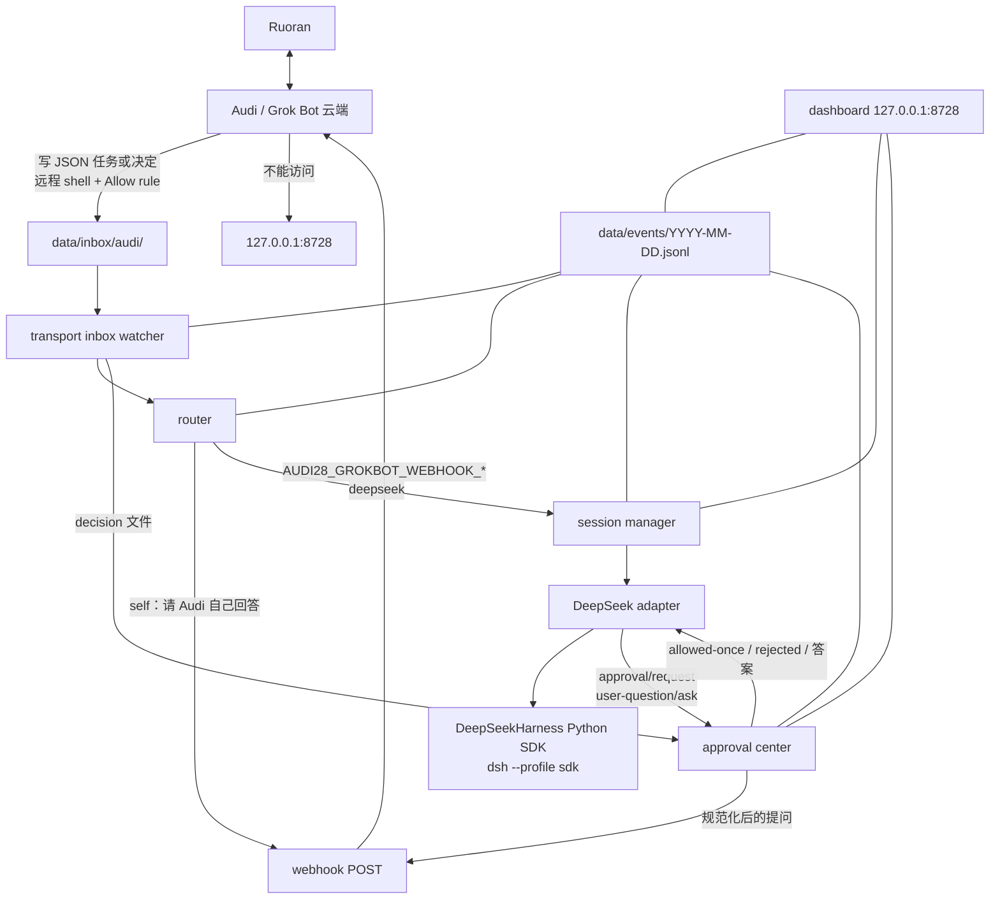
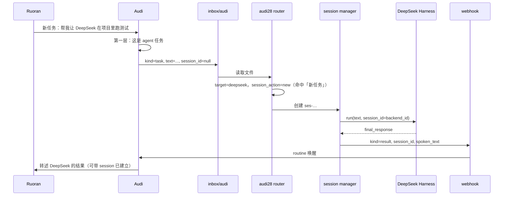
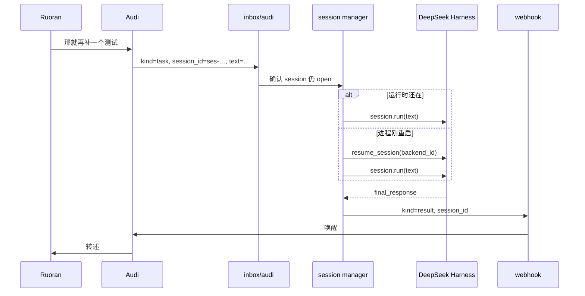
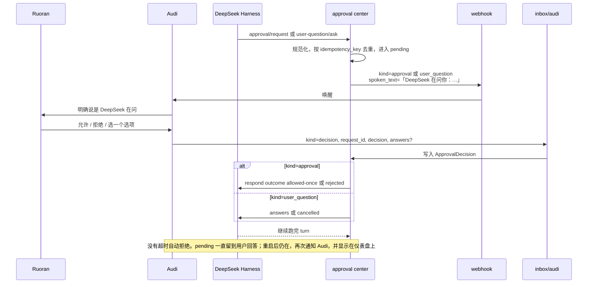

# audi28 设计文档

> 状态：2026-11-20 的决定已写入正文。Phase 1 的骨架、传输、规则路由、session 存储、DeepSeek adapter，以及审批中心和本机仪表盘已在本仓库。Claude Code 与 Codex 的 hook 适配器还没做。
> 日期：2026-11-19 起草（America/New_York），2026-11-20 按 Ruoran 的决定改定。
> 项目位置：Mac 上 `~/Code/audi28`，与 `~/Code/audi27` 并列。本仓库就是这份实现。

## 1. 背景与文档来源

Ruoran 的需求：自己跟 Audi（Grok Bot）对话，由 Audi 做 routing，把该交给 coding agent 的消息传到本机的 DeepSeek Harness，并维护 session。之后 DeepSeek 有问题要问时，Audi 必须向用户说清楚「是 DeepSeek 在问」。第一阶段只接通 DeepSeek Harness；Claude Code 和 Codex 留到后续阶段，但审批中心的接口要一次设计好。

主来源是 DaDa 根据 2026-11-18 晚上语音通话调研整理的文档：

- box 上：`/workspace/docs/approval-hub-harness-interfaces.md`
- 同时作为附件保存在 DaDa 的 agent attachments 里（与上一份内容相同）
- 本仓库副本：[`sources/approval-hub-harness-interfaces.md`](sources/approval-hub-harness-interfaces.md)

文档说明：Claude Code 的 `settings.json` 示例和 Codex 的 hook 脚本是按官方格式写的，**还没有实际跑过**。本文把未跑通的细节标为「未验证」，不把它们当成已实现的合同。

在 Mac 上按只读方式查找了这份文档：`~/Code` 里最近 3 天的 md/pdf/docx 没有独立副本。`~/Downloads`、`~/Desktop`、`~/Documents` 的 `listdir` 在约 5 秒内无响应（很可能是 iCloud 挂起），Spotlight（`mdfind`）在这些目录里也没有搜到含 “DeepSeek Harness” 或 “PermissionRequest” 的文稿。因此不以 Mac 本地文件为来源，而以 DaDa 整理的那份为准，并用官方文档交叉核对。

## 2. 目标与非目标

### 目标（Phase 1）

- 在 Mac 上跑一个与 audi27 **解耦**的本地服务 audi28，作为「agent 会话层 + 统一审批中心」。
- 用户只跟 Audi 说话。Audi 做第一层判断：自己回答，还是交给本机 agent。交给 agent 的消息写入 audi28；audi28 再做一次 routing（Phase 1 只有 DeepSeek，也必须留下这条判断并记入事件）。
- 接通 DeepSeek Harness 的 **Python SDK**（`deepseek-harness-sdk`），创建、恢复、列出、关闭 session，进程重启后仍能对上 DeepSeek 的 persisted session。
- DeepSeek 的 `approval/request` 和 `user-question/ask` 都进入同一个审批中心，由 Audi 转述给用户，用户的决定再回到 Harness。不点 DeepSeek 的 UI。
- 面向用户的每条提问都标明来源，例如「DeepSeek 在问你：…」。口述时不报路径、不报链接。
- 审批中心的 schema 对 Claude Code（HTTP `PermissionRequest` hook）和 Codex（command hook + curl）保持兼容，但 Phase 1 不实现这两条适配器。
- 复用 audi27 里已经跑通的模式：Python + uv、`config.toml`、append-only JSONL 事件、supervisor、`127.0.0.1` 仪表盘。

### 非目标（Phase 1 不做）

- 不实现 Claude Code、Codex 适配器，不改用户的 Claude / Codex 配置。
- 不把 audi28 嵌进 audi27 进程，不复用 8727 端口，不共用 `data/`。
- 不自动批准任何可能有破坏性的操作（写文件、跑 shell、装包、改 git、访问工作区以外的路径）。
- 不做公网暴露、不做 relay/隧道（Phase 1 传输走文件 inbox + webhook）。
- 不做 Muse、本地模型、多模型 LLM router。
- 不恢复 DeepSeek 在 session 里拉起的 shell / browser 等外部进程（官方 SDK 明确不恢复这些）。
- 不提供「永久允许这类工具」；DeepSeek 侧一次批准只对应 `allowed-once`。

## 3. 与 audi27 的关系

audi27 是常驻语音秘书：录音、唤醒、转写、turn、route、dispatch、队列播报。它已经能通过 Grok Bot webhook 把一句话发给 Audi，再从 `~/Code/audi27/data/inbox/grokbot/` 读回复文件。Audi 不能访问 Mac 的 localhost HTTP；云端写回 Mac 目前靠远程 shell，且只有该 inbox 目录有一条 Allow rule。

audi28 是**独立服务**。两者可以同机并列运行，通过文件或本地 CLI 以后再对接，而不是共享一个 supervisor。

- 现在：用户主要在 Audi 的聊天/语音里下任务，不经过 audi27 的 route。
- 以后：audi27 可以把语音 turn 写成 audi28 的 inbox 任务（或调用 `audi28 submit`），让「达达，让 DeepSeek 去改这个仓库」走同一套会话和审批。接口先留着，Phase 1 不实现这条桥。
- 配置、事件、端口、环境变量前缀全部用 `audi28` / `AUDI28_`，避免和 audi27 互相覆盖。
- 仪表盘端口默认 `127.0.0.1:8728`（audi27 是 8727）。

## 4. DeepSeek Harness：已核对的事实

官方仓库：[deepseek-ai/deepseek-harness](https://github.com/deepseek-ai/deepseek-harness)。

| 能力 | 事实 | 来源 |
| --- | --- | --- |
| CLI | `dsh`。`dsh --profile sdk` 向 SDK 客户端提供 stdio JSON-RPC；`dsh --profile headless` 跑完一个任务就退出 | [CLI help](https://github.com/deepseek-ai/deepseek-harness/blob/master/docs/cli-help.md) |
| TypeScript SDK | `@deepseek-ai/dsh-sdk-client`。`approvalRequests: true`，`client.start()` 后用 `client.onRequest` 处理 `approval/request` | [TS client README](https://github.com/deepseek-ai/deepseek-harness/blob/master/packages/sdk/client/README.md) |
| Python SDK | 包名 `deepseek-harness-sdk`，本仓库钉在 PyPI 上的 `0.2.2rc2`（会装同版本的 `deepseek-harness-runtime-bin`）。启动捆绑的 `dsh --profile sdk`。公开入口是 `DeepSeekHarness` / `DeepSeekHarnessConfig`、`start_session`、`resume_session(session_id)`、`Session.run`、`client.next_request`、`client.respond`，用户提问走 `on_user_question`。这个版本的 `resume_session` 只收 session id，没有 permission 参数 | [Python SDK README](https://github.com/deepseek-ai/deepseek-harness/blob/master/python/sdk/README.md)，以及 PyPI `0.2.2rc2` 的 wheel |
| 传输 | newline-delimited JSON-RPC 2.0，走子进程 stdio。文档里没有 REST API | [wire protocol](https://github.com/deepseek-ai/deepseek-harness/blob/master/packages/sdk/protocol/README.md) |
| 认证 | 子进程继承环境变量 `DEEPSEEK_API_KEY`、`DEEPSEEK_BASE_URL`；也可用构造参数 `api_key` / `base_url` 覆盖。必须显式给 `dsh_home`，SDK **不会**去发现 `~/.dsh` | 同上 Python README |
| Session 创建 | `harness.run(text, session_id=...)` 或 `start_session(id)`（后者只是懒句柄，不恢复已持久化的会话） | 同上 |
| Session 恢复 | `harness.resume_session(saved_id)` 从同一个 `dsh_home` + workspace 恢复历史，不发送新输入。缺失、不可读、不兼容或已被占用的 id 会报错，**不会**另建一个顶替。不恢复 shell / browser 等外部进程 | 同上 |
| 权限预设 | 标准 `sdk` profile 有 `read-only`、`workspace-write`、`danger-full-access`。恢复时可选覆盖。`sdk-minimal` 没有这套权限服务 | 同上 |
| 审批（Python） | `approval_requests=True`。必须另开线程/循环调用 `client.next_request()`，与 `run()` / `session/wait` **并发**。对 `approval/request` 用 `client.respond(id, {"outcome": "allowed-once"\|"rejected"\|"cancelled"})`。没有处理函数时 fail closed。决定是一次性的；连接断开则待决请求失败关闭 | 同上，以及 [`examples/manage_plugins.py`](https://github.com/deepseek-ai/deepseek-harness/blob/master/python/sdk/examples/manage_plugins.py) |
| 审批请求字段 | `ApprovalRequestParams`：`sessionId`、`toolName`、可选 `callId`、可选 `reason` | [protocol README](https://github.com/deepseek-ai/deepseek-harness/blob/master/packages/sdk/protocol/README.md)、[Rust docs](https://docs.rs/deepseek-harness-sdk-rs/latest/deepseek_harness_sdk_rs/client/struct.ApprovalRequestParams.html) |
| 用户提问 | `on_user_question` 回调（Python）或 `userQuestions` capability。运行时发 `user-question/ask`：`{requestId, sessionId, questions}`。回答 `{answers:[{id, selected, custom?}]}`（`selected` 是标签列表，每个问题 id 恰好一次），或 `{cancelled: true}` 表示用户关闭。`user-question.cancelled` 通知后应丢掉迟到的回复 | protocol README、Python SDK README |
| 已知限制 | 没有 session-close / cancel 的 RPC；放弃一轮要关运行时进程。`user-question` 的 request id **不能**在运行时重启后继续回答 | protocol「Known Limitations」 |

说明：DaDa 文档和 TypeScript 示例用的是 `client.onRequest(...)`。Python 镜像同一套协议，但公开 API 是 `next_request()` + `respond()`，外加独立的 `on_user_question`。audi28 按 Python API 写，不要照抄 TS 回调签名。

Phase 1 用完整 `sdk` profile（需要权限预设），`dsh_home` 放在项目下的 `data/dsh-home`，不要用 `~/.dsh`。默认权限 `workspace-write`，并打开 `approval_requests`，这样写操作仍要经过审批中心。加载配置时只接受 `read-only` 和 `workspace-write`，拒绝 `danger-full-access` 以及其它值。也不要使用 headless 的 `--approval-policy never`。PyPI 上钉住的 `deepseek-harness-sdk==0.2.2rc2` 没有 `permission_mode` 构造参数，`resume_session` 也只收 session id。工作区用 `cwd` 传给 SDK（目录不存在就创建）。权限预设在每次 `start_session` / `resume_session` 之后，用 `Session.run("/permission workspace-write")` 设上，再跑用户的提示。上游 master 的 README 写了 `resume_session(id, {"permission_mode": ...})`，这个已发布版本还没有那个参数，不要按 README 去传。`start()` 在 `start_session()` 返回后立刻把 backend session id 写进 session 文件，然后才把提示交给会话自己的工作线程。传输循环不在 `run()` 里等待审批。同一个 session 同时只跑一轮，后续提示排队。审批线程遇到不认识的请求用 `respond_error(-32601)` 回答。传输循环退出时，以及 SIGINT / SIGTERM 让循环停下来时，调用 backend `close()`：给每个会话队列送结束标记，`harness.close()` 回收 `dsh` 子进程，再在超时内等会话线程和审批线程退出。

默认 workspace 是 `~/Code/deepseek-workspace`，写在 `config.toml` 的 `[deepseek] workspace`，可以改成另一个目录。加载配置时把 `~` 展开成绝对路径。没写 workspace，或写成相对路径，都是配置错误，不会悄悄改用 `$HOME` 下的别的目录。`workspace-write` 只划定 DeepSeek 能碰到的目录；每一次工具调用仍然进入审批中心。

## 5. 架构



以后 Claude Code / Codex 只接到 **approval center**（本机 HTTP 或 hook 脚本 → `127.0.0.1`），不进入 DeepSeek adapter。它们的提问同样经 Audi 转述。

进程模型与 audi27 相同：`./start.sh` → `audi28 supervise` 拉起少量常驻子进程（核心 loop、inbox、web）。DeepSeek 运行时活在核心 loop 里，不要每个任务重新拉起一次 `dsh`。

## 6. 组件

| 组件 | 职责 | Phase 1 |
| --- | --- | --- |
| `config` | 加载 `config.toml` + `.env`，未知 section 要报错（audi27 的教训） | 做 |
| `events` | append-only JSONL，字段与 audi27 一致：`id, ts, type, source, ref, data`。不认识的 type 照样保存 | 做 |
| `transport` | 看 inbox；向 Grok Bot webhook 发消息；把文件移到 `processed/` 或 `quarantine/` | 做 |
| `router` | 可插拔接口。规则引擎先做；可选 LLM 以后再加。产出 `deepseek` 或 `audi_self`，以及继续 session 还是新开，并带 `reason`。写入 `route` 事件 | 做（仅规则） |
| `sessions` | audi28 `session_id` ↔ backend + backend session id；持久化；list / close / 过期 | 做 |
| `adapters.deepseek` | 启动/复用 Harness，`run` / `resume_session`，并发排空 `next_request`，挂上 `on_user_question` | 做 |
| `approval` | 规范化 `ApprovalRequest` / `ApprovalDecision`。pending 一直等到用户回答，不自动拒绝；重启后仍在，可再次提醒；幂等、审计事件 | 做 |
| `format` | 生成带来源标签、适合口述的中文 | 做 |
| `web` | 本机仪表盘：session、待审批、最近事件 | 做（只读为主） |
| `supervisor` / `cli` / `doctor` | 启停、健康检查（SDK 是否安装、`dsh_home`、密钥是否存在、inbox 是否可写、kws 式的 liveness 可省略） | 做 |
| `adapters.claude_code` / `adapters.codex` | HTTP hook 与 curl 脚本 | 以后 |

模块之间只通过事件和明确的函数接口说话，adapter 不直接写 webhook，审批中心不直接 import DeepSeek SDK。

## 7. 传输方案（Audi ↔ Mac）

约束：Audi 在云端，**不能** HTTP 访问 Mac 的 `127.0.0.1`。今天 audi27 的做法是：Mac 用 webhook 叫醒 Audi；Audi 把回复 JSON 写进 `~/Code/audi27/data/inbox/grokbot/`。任何其它 Mac 写入都要 Ruoran 当场批准。

### 方案对比

| 方案 | Audi → audi28 | audi28 → Audi | 优点 | 缺点 |
| --- | --- | --- | --- | --- |
| **A. 文件 inbox + webhook**（与 audi27 相同） | Audi 经远程 shell 把 JSON 写入 `~/Code/audi28/data/inbox/audi/` | audi28 向独立的 Grok Bot webhook routine POST | 已经验证；实现快；不暴露端口；和现有 Allow 模型一致 | 靠轮询（可到 0.1–0.2 秒）；要一条新的 Allow rule；webhook 与文件可能乱序，必须靠 id 对齐 |
| **B. Relay / 隧道**（Cloudflare Tunnel、ngrok 等） | Audi 直接 HTTPS 调用 audi28 | audi28 也可推，或 Audi 轮询 | 双向 HTTP，延迟更清晰，以后接非本机客户端也方便 | Phase 1 多一块基础设施和攻击面；要证书、鉴权、保活；对 MVP 过重 |
| **C. Audi 远程调用 CLI** | Audi 在 Mac 上执行 `uv run audi28 submit ...` | `audi28 wait` 或把结果写到 stdout / 文件 | 少一个常驻 watcher | 每次副作用命令都要批准（除非再写更宽的 Allow）；长时间 `run()` 不适合同步 CLI；审批到来时 Audi 不一定还在执行那条命令 |

### Phase 1 推荐：方案 A

workflow：

1. Audi 判断这是 agent 任务（或用户的审批回答），写入 inbox 文件。
2. `audi28` 的 inbox watcher 读到后写事件，路由或把决定交给审批中心。
3. DeepSeek 的提问或最终回复，由 audi28 POST 到 `AUDI28_GROKBOT_WEBHOOK_URL`。
4. Audi 对用户说话（提问必须带「DeepSeek 在问你」）。用户回答后，Audi 再写一个 decision / follow-up 文件。

webhook 与 audi27 **分开**：专用 routine，提示词知道 session、来源标签、以及要把 `session_id` / `request_id` 原样写回。不要复用 `AUDI27_GROKBOT_*`，以免两条产品线抢同一个 inbox。

### Allow rule（2026-11-20 已批准）

Ruoran 已同意下面这一条，且只同意这一条。实现时不要扩大写入范围：

> Allow Audi to copy JSON files from its box into `~/Code/audi28/data/inbox/audi/` on my Mac (machine 806b8af2), creating that folder if needed, without asking; any other write on my Mac still needs my approval.

`processed/`、`quarantine/` 由本机 audi28 进程移动，不需要这条规则。密钥和 URL 仍只放 `.env`，不进 `config.toml`，也不进事件或日志。

### 传输行为

Inbox 根目录是 `data/inbox/audi/`。watcher 只认这里的 `*.json`，不跟随 symlink，也不把子目录里的文件再当新任务。

领取是原子的：先把文件 `rename` 到 `processing/`，再看领到的那个文件。两个进程同时看到同一个名字时，只有一个 rename 成功。检查发生在领取之后，避免刚判断完它不是 symlink、文件却被换掉。然后：

- 领到的是 symlink，或大小超过 `[inbox] max_bytes`：立刻移到 `quarantine/`，不读链接目标，也不把超限的正文读进内存。记一条 `error`。
- JSON 解析失败，或解析结果不是对象，或缺少非空字符串 `kind` / `message_id`：留在 `processing/`，按 `[inbox] parse_retries` 个 tick 再试。用尽后移到 `quarantine/`，记一条 `error`。
- 合法文件先追加 `inbox_received`（`source` 为 `inbox`，`ref` 为 `message_id`，`data.message` 是原文），文件留在 `processing/`。dispatch 处理完每一种 `kind`（包括 `task`、`close_session` 和其它）都再写一条 `inbox_done`，`ref` 仍是这个 `message_id`。没有 `inbox_done` 的才算没做完，重启会再交给 dispatch。已经有 `inbox_done` 的不再处理第二次。`task` 如果已经写过 `route` 也不再路由一次。同一 `message_id` 的另一份文件，或同一个 `idempotency_key`，不重复记 `inbox_received`。事件里不写绝对路径。做完后文件进 `processed/`。

出站先落在 `data/outbox/grokbot/pending/`，再 POST。`flush` 持有这个 outbox 的排他锁（线程锁，再加 `fcntl` 的 `.lock`），发送过程中不放开。发送前原子地改名为 `inflight/`，并记下认领它的进程。成功后进入 `sent/`。如果这时文件已经不在了，仍然记 `webhook` 事件，不因为 `rename` 失败把这次成功丢掉。另一个活着的进程认领的 `inflight/` 文件不能被抢走。没有活进程认领的（进程已经退出，或根本没写上认领者）下一次 flush 放回 `pending/` 再发。pending 里解析不了、或没有对象形态 `payload` 的文件进 `quarantine/`，记一条 `error`，不要留在原地永远跳过。URL 和 key 只来自 `AUDI28_GROKBOT_WEBHOOK_URL` 和 `AUDI28_GROKBOT_WEBHOOK_KEY`。它们不进 outbox 文件、事件或日志。缺其中任何一个时不发请求，pending 原样留着。

supervisor 的传输循环碰到异常时记一条 `error`（不写进密钥和 URL），然后继续跑。不要把异常吞掉。

同一次 flush 里，网络错误或超时按短退避再试一次。仍然失败就记 `error`，文件回到 pending，并推迟下一次尝试，避免 supervisor 空转时打满对端。非 2xx 不在同一次 flush 里重试，同样记 `error` 并留在 pending，重启后还会再试。2xx 记一条 `webhook` 事件（`status` 为 `sent`）。入队时另记一条 `webhook`（`status` 为 `queued`）。成功和失败的事件都不含 URL、key 或 Authorization 头。

`audi28 grokbot test` 用当前环境把一条测试消息走这套 outbox。测试和 CI 只打本机假 HTTP server，不访问真实 webhook。

## 8. Session 模型

- audi28 自己生成 `session_id`（例如 `ses-<uuid>`），不要直接拿 DeepSeek 的 id 当对外 id，方便以后一个会话模型下挂多个 backend。
- 映射表持久化在 `data/sessions/<session_id>.json`，并写 `session` 事件。`session` 事件带上路由决定里的 `reason`。命令行 `sessions close` 也写一条。重启后以文件为准，事件可重建。`close`、`touch`、`set_handle` 在同一把排他锁里读改写（线程锁再加 `fcntl`），避免后写入的旧状态把已关闭的 session 重新打开，或丢掉 `last_task_id`。
- 每条记录至少包含：`session_id`、`backend`（Phase 1 只有 `deepseek`）、`backend_session_id`（backend 的 session handle）、`workspace`、`status`（`open` / `idle` / `running` / `closed` / `error`）、`created_ts`、`updated_ts`（最后活跃时间）、`pending_questions`（还没回答的提问数，Phase 1 先记着，审批中心以后来改）、`last_task_id`、`title`（可从首条任务截断）。
- 开新 session 还是继续上一个，由 router 决定，见第 9 节。决定成新 session 之后，调用 `harness.run(..., session_id=backend_session_id)`。把两个 id 都写进发给 Audi 的结果。Audi 可以在后续消息里带回 `session_id`；没带回、也没明确要新任务时，仍然继续最近一个仍开放的 session。
- 同一 session 的跟进：若 DeepSeek 运行时还在，直接 `session.run(text)`；若进程刚重启，先 `resume_session(backend_session_id)` 再 `run`。`dsh_home` 和 workspace 必须与创建时相同。
- 多个 session 可以并存。推荐一个长期存活的 `DeepSeekHarness`。官方说明 `run()` 可以重叠且不会互相吃掉结果；Phase 1 仍按 session **串行** 执行（每个 session 一个队列），避免审批和提问交错难理。不同 session 之间可以并行，若实现成本高，MVP 先全局串行也行，在代码里留出队列边界。
- 关闭：用户或 Audi 发 `kind: close_session`。audi28 把状态标为 `closed`，不再接受新输入。协议没有 session-close RPC，关闭时不必杀掉整个运行时（以免牵连其它 session）。放弃一轮进行中的 turn，官方做法是关掉运行时进程——Phase 1 只支持「取消待审批」（回 `cancelled` / `{cancelled:true}`），不保证能中止已经在跑的工具。这一点要在 `doctor` 和文档里写清楚。
- 过期：`[sessions] idle_timeout_s`（建议默认 24 小时无新消息则标 `idle`，不自动关闭，避免误杀）。`closed` 的不再 resume。列出时默认隐藏已关闭的。
- 没明确要新任务时，继续最近一个仍开放的 session，不看 6 小时窗口，也不要求「恰好只有一个」。`idle` 只是标记，不因此另开 session。细节和 `reason` 见第 9 节。
- 运行时重启后，官方限制是：尚未回答的 `user-question` request id 不能再提交。audi28 不因此自动拒绝，也不把这条提问标成过期后丢掉。pending 留在事件里，重启后还在，仪表盘上看得到，并会再次告诉 Audi。用户回答之后，如果当时的 runtime 已经不收这个 request id，就把回答记下来，说明这次送不回去，请 DeepSeek 再问一次。不假装已经回答了运行时。

## 9. Routing

```python
class Router:
    def decide(self, message: TaskMessage, context: RouteContext) -> RouteDecision:
        ...

# RouteDecision:
#   target: "deepseek" | "audi_self"
#   session_action: "continue" | "new" | "none"
#   session_id: str | None
#   reason: str          # 必填。人能看懂为什么是这个决定
#   rule_id: str | None
```

每一次判断都追加一条 `route` 事件：`source` 为 `router`，`ref` 为 inbox 的 `message_id`，`data` 就是上面的 `RouteDecision`。不认识的 `type` 仍照常保存；`route` 只是建议类型之一。

Phase 1 只用规则，配置在 `config.toml` 的 `[route]`。规则先做。以后可以把 LLM 判断插进同一个接口：它能看更宽的上下文；超时或解析失败就回到下面这套规则，不另开一条状态机。

先决定交给谁：

1. 显式：用户或 Audi 指定 backend（`target: deepseek`）——直接采用。
2. 显式自答：「你直接回答」「不用 DeepSeek」等 → `audi_self`。
3. 默认：已经进了 audi28 inbox 的消息，默认 `deepseek`（Audi 的第一层过滤应当已经把闲聊拦下）。仍要写出 `reason`。改代码、跑测试这类关键词不再单独做一条规则，因为默认已经是 `deepseek`。

`audi_self` 的意思是：**不要**开 DeepSeek session，也不要去继续一个。`session_action` 为 `none`，`session_id` 为 null。audi28 以后向 Audi webhook 回 `kind: self`，请 Audi 用自己的能力回答。Audi 在第一层也可以根本不写 inbox。两层都做判断，是为了 Audi 误放行时还能拦下来，并留下审计。

`target` 是 `deepseek` 时，再决定 session。默认是**继续**最近一个仍开放的 session。只有用户明确说要新任务时才另开。没有仍开放的 session 时，只能新开。Phase 1 的规则看任务正文，不靠计时窗口。消息里显式带了 `session_id` 时，这条覆盖新任务说法，继续那个 id：

1. 消息带了非空 `session_id` → `session_action=continue`，就用这个 id。`reason` 写明是消息点名的 session。正文里即使有「新任务」也不另开。这个 id 已经 `closed` 或不存在时，router 仍给出 `continue` 和这个 id；session 层拒绝这轮输入，不要悄悄另开一个来顶替。
2. 否则，正文明确要新任务。默认说法是 `新任务`、`开一个新的`、`另外一个任务`、`new task`（`[route] new_task_phrases`，可再加）。比较时按子串，忽略首尾空白，只对 ASCII 字母忽略大小写。`reason` 写明命中了哪一条。否定说法盖住里面的新任务词：`不是新任务` 不算新任务，`接着上一个` 也不算。这些写在 `[route] not_new_task_phrases`。一个新任务词的整段落在某条否定说法里，就不当成命中。
3. 否则，继续最近更新的仍开放 session（`open` / `idle` / `running`，按 `updated_ts`）。`closed` 和 `error` 不在此列。有好几个时用最近的那个，不要求恰好只有一个。`reason` 写明「没有新任务说法，继续最近一个仍开放的 session」。
4. 一个可继续的 session 都没有 → `session_action=new`。`reason` 写明是因为没有仍开放的 session，而不是因为用户要求新任务。

`idle_timeout_s` 只把长时间没消息的 session 标成 `idle`，不自动关闭，也不因此开新 session。不再使用 `sticky_s`。

## 10. 审批中心

三个工具在边界上转换成同一对 schema。Phase 1 只由 DeepSeek adapter 调用；HTTP 入口留给 Claude Code。

### ApprovalRequest

```json
{
  "id": "apr-7c2e1a0b",
  "session_id": "ses-aa10",
  "source_agent": "deepseek",
  "source_label": "DeepSeek",
  "kind": "approval",
  "tool_name": "plugin_manager",
  "call_id": "call-19",
  "reason": "Install a plugin in the workspace",
  "summary": "申请安装一个插件，只批准这一次。",
  "detail": {
    "raw_method": "approval/request",
    "backend_session_id": "dsh-session-…",
    "rpc_id": 42
  },
  "questions": null,
  "created_ts": "2026-11-19T22:10:00.000-05:00",
  "idempotency_key": "deepseek:dsh-session-…:call-19"
}
```

用户提问时 `kind` 为 `user_question`，`questions` 保留官方结构（`id`、问题文本、选项、`detail` 等），`idempotency_key` 用 `deepseek:<sessionId>:<requestId>`。

### ApprovalDecision

```json
{
  "id": "apd-33",
  "request_id": "apr-7c2e1a0b",
  "decision": "allow",
  "message": null,
  "answers": null,
  "source": "user",
  "ts": "2026-11-19T22:11:12.000-05:00"
}
```

`decision` 为 `allow` | `deny` | `cancel`。`source` 为 `user` | `rule`。没有 `timeout`：到点不会自己产生决定。Phase 1 不提供 `rule` 自动放行破坏性操作；规则最多能 **deny**。

映射到 DeepSeek：

| 规范化 | `approval/request` | `user-question/ask` |
| --- | --- | --- |
| `allow` | `{outcome: "allowed-once"}` | 按 `answers` 填每个问题 id（用户选了选项或自定义文本） |
| `deny` | `{outcome: "rejected"}` | 没有合适映射时用 `{cancelled: true}`，并在事件里标明这是拒绝而非用户关闭 |
| `cancel` | `{outcome: "cancelled"}` | `{cancelled: true}` |

没有超时这一行。pending 不因为等太久而变成 `rejected` 或 `{cancelled: true}`。

Claude Code / Codex 以后映射为 hook 的 `allow` / `deny`（可选 `message`）。注意 DeepSeek 的允许是一次性的 `allowed-once`，不要在用户文案里说成「以后都允许」。

状态：`pending` → `decided` | `cancelled_by_backend`。同一 `idempotency_key` 已有 pending 则复用；已有终态则不再问用户，并把原决定返回给 backend（若 backend 仍在等）。官方说取消后迟到的回复会被丢掉。连接断开时，DeepSeek 侧可能已经把这次请求 fail closed；那是运行时的行为。audi28 自己不补一条 deny。若确认 backend 已取消，状态记为 `cancelled_by_backend`，并告诉 Audi。

审批和提问一直等到用户回答。配置里没有 `timeout_s`，也没有 `timeout_action`。不要把 600 秒写回来。pending 追加为事件，重启时从事件日志重建还没有决定的条目。启动时对每一条再发一次 webhook（`reminder: true`），文案以「DeepSeek 在问你：」开头，仪表盘列出它们。提醒发不出去也保持 `pending`，不改成 deny。仪表盘不提供「一键永久允许」。

可选的 `[approval] remind_after_s` 默认不写。写了就在这么多秒后把同一条提问再发给 Audi 一次，状态仍是 `pending`，不会变成拒绝。

本机可以用 `audi28 approvals list` 和 `audi28 approvals decide <id> allow|deny [--note]`。决定和 inbox、仪表盘走同一个 `decide`。同一条决定到第二次不再改状态，并给 Audi 一条说清楚的错误。不知道的 id 同样回错误。

仪表盘在 `127.0.0.1:8728`。除 `/health` 外需要环境变量 `AUDI28_DASHBOARD_TOKEN`（`Authorization: Bearer`，或 `?token=`）。批准按钮要求 JSON、loopback Host，并拒绝跨站 `Sec-Fetch-Site`。

Claude Code 自己的 HTTP hook 默认最多等 600 秒，Codex 示例脚本里的 curl 也写了 `--max-time 600`（见 sources 文档）。那是那些工具的外部上限，不是 audi28 的策略。audi28 不会到点发 deny。Phase 2/3 接上它们时要单独处理这个外部上限。

`user-question` 的 request id 在 DeepSeek 运行时重启后不能再提交。这不把 pending 自动清掉。处理方式见第 8 节：条目留在仪表盘，用户的回答要记下来；送不回去就说实话，请 DeepSeek 再问一次。

每条请求和决定都追加事件，作为审计日志。密钥、完整绝对路径、环境变量不要进 `summary`，可留在仅供本机查看的 `detail`（仪表盘默认折叠，口述时不用）。

## 11. 面向用户的文案

Audi 发出去的口语/聊天文本由 audi28 在 webhook 的 `spoken_text`（以及更完整的 `text`）里给好，避免 Audi 自己发挥时漏掉来源。

示例：

- 审批：「DeepSeek 在问你：是否允许它安装一个插件？只批准这一次。请回答允许或拒绝。」
- 用户提问：「DeepSeek 在问你：计划是先跑测试再提交。要按这个计划继续吗？」若有选项，逐条读出来，不要读路径。
- 完成：「DeepSeek 说：测试已经通过，改动还没提交。」
- 自答回退：「这条我建议自己回答，没有交给 DeepSeek。」
- 送不回运行时：「DeepSeek 刚才那条提问已经送不回去了。需要的话让它重新问一次。」

`spoken_text` 里禁止出现文件系统路径、URL、token。完整细节只放在 `text` / 仪表盘，供用户看屏幕时使用。

## 12. 消息流

### (a) 明确要新任务

下面是用户明确说出新任务（例如「新任务」）时的路径。没说新任务时走 (b)，即使 inbox 里的 `session_id` 是 null。



### (b) 继续最近一个 session

用户没有明确要新任务。Audi 可以带上 `session_id`，也可以不带。router 写下 `session_action=continue` 和 `reason`。图里的 `ses-…` 是这条决定选出的 session。



### (c) DeepSeek 的审批或提问



## 13. 数据 schema 与事件

事件文件：`data/events/YYYY-MM-DD.jsonl`，本地日期，一行一个 JSON。固定字段与 audi27 相同。建议 type（不是白名单，读的时候不要拒绝未知类型）：

`inbox_received`、`inbox_done`、`route`、`session`、`task`、`approval`、`decision`、`reply`、`error`。

inbox 文件（Audi → audi28），一个文件一个 JSON，文件名建议 `<uuid>.json`：

```json
{
  "kind": "task",
  "message_id": "msg-01",
  "session_id": null,
  "target": null,
  "text": "在仓库里跑测试，把失败的补上。",
  "ts": "2026-11-19T22:08:00.000-05:00"
}
```

```json
{
  "kind": "decision",
  "message_id": "msg-02",
  "session_id": "ses-aa10",
  "request_id": "apr-7c2e1a0b",
  "decision": "allow",
  "answers": null,
  "text": "允许",
  "ts": "2026-11-19T22:11:12.000-05:00"
}
```

其它 `kind`：`close_session`、`cancel`（取消某条 pending 请求）。同一 `message_id` 不处理第二次。格式不对或 JSON 解析连续失败的，移到 `quarantine/`（行为对齐 audi27：解析失败先重试几个 tick）。不跟随符号链接，超过 1MB 的直接隔离。

webhook 体（audi28 → Audi）：

```json
{
  "kind": "approval",
  "task_id": "apr-7c2e1a0b",
  "session_id": "ses-aa10",
  "request_id": "apr-7c2e1a0b",
  "source_agent": "deepseek",
  "source_label": "DeepSeek",
  "status": "needs_decision",
  "spoken_text": "DeepSeek 在问你：是否允许它安装一个插件？只批准这一次。请回答允许或拒绝。",
  "text": "DeepSeek 申请使用工具 plugin_manager。原因：Install a plugin in the workspace。",
  "ts": "2026-11-19T22:10:00.000-05:00"
}
```

结果用 `kind: result`、`status: done`；失败用 `kind: error`、`status: failed`；`self` 回退用 `kind: self`。Audi 的 routine 应把 `spoken_text` 读给用户，并把 `session_id` / `request_id` 记在对话里以便写回。

## 14. 安全

- 仪表盘和以后的 hook HTTP 只绑 `127.0.0.1`，不绑 `0.0.0.0`。
- webhook 和（以后）hook 端点使用 token。Token 只来自环境变量 / `.env`。Claude Code 的 hook header 用 `allowedEnvVars`，不要把 token 写进仓库里的 `settings.json`。
- Phase 1 不对写文件、shell、插件安装、git、工作区以外的路径做 auto-approve。
- 默认权限预设是 `workspace-write`。加载时只接受 `read-only` 和 `workspace-write`，拒绝 `danger-full-access`。工具调用仍要经过审批。workspace 默认是 `~/Code/deepseek-workspace`，写在 `config.toml` 里；加载时把 `~` 展开成绝对路径。没写、或写成相对路径，都是配置错误，不会悄悄改用 `$HOME` 下的另一个目录。
- 日志和事件做 redact（URL、key）。inbox 不跟随 symlink。
- DeepSeek 的 `dsh_home` 隔离在项目 `data/` 下。
- 本机写 API（若仪表盘以后要批准按钮）必须要求 JSON、loopback Host，并拒绝跨站 `Sec-Fetch-Site`（对齐 audi27 的 `/api/confirm`）。

## 15. 目录布局（实现时）

```
~/Code/audi28/                 # 与 audi27 并列。仓库：https://github.com/abharosim/audi28
  README.md
  AGENTS.md
  .gitignore
  .github/workflows/ci.yml
  config.example.toml
  config.toml                  # 本地，gitignore
  .env                         # 本地，gitignore：AUDI28_GROKBOT_* 、DEEPSEEK_API_KEY
  pyproject.toml
  uv.lock
  start.sh
  docs/
    DESIGN.md
    sources/approval-hub-harness-interfaces.md
  audi28/
    __init__.py
    cli.py
    config.py
    events.py
    supervisor.py
    transport.py
    router.py
    sessions.py
    approval.py
    format.py
    web.py
    doctor.py
    adapters/
      base.py
      deepseek.py
  tests/
  data/                        # gitignore；运行时
    events/YYYY-MM-DD.jsonl
    inbox/audi/{processing,processed,quarantine}/
    outbox/grokbot/{pending,inflight,sent,quarantine}/
    sessions/
    dsh-home/
    audi28.log
```

Phase 1 代码按上面拆模块，但每个 PR 只交能独立验证的一小步，避免一上来就搭空架子。

## 16. Phase 计划

### Phase 1 — 接通 DeepSeek（按 PR 拆分）

**PR 1 — 骨架。** `pyproject.toml`（Python ≥ 3.10，uv，dev extra 里有 pytest）、`config` 加载器（未知 section 报错）、`events`（append / follow / replay，与 audi27 字段一致）、`cli`（`events`、`supervise`、`web`、`doctor`）、`supervisor`、`start.sh`、`config.example.toml`、`.gitignore`（`.env`、`data/`、`.venv`）、GitHub Actions 跑 `pytest`。`doctor` 在缺少 `DEEPSEEK_API_KEY` 时说明怎么补，并且不崩溃；其它 doctor 检查仍留在 PR 6。验收：`uv sync --extra dev` 后 `pytest` 通过；能 append 并 replay 一条事件；`start.sh` 能拉起 web 在 `127.0.0.1:8728`；伪造的未知 event type 被保存而不是丢弃。

**PR 2 — 传输。** 行为见第 7 节「传输行为」：inbox 原子领取、按 `message_id` 幂等、坏文件隔离、webhook outbox（短退避、重启后续发）、每次收发都写事件。`audi28 grokbot test`。验收：向临时目录写入合法 `task` 文件会得到 `inbox_received` 事件并移到 `processed/`；坏 JSON 在重试后进入 `quarantine/`；symlink 和超大文件被隔离；用本地 HTTP server 测 webhook：2xx 成功，非 2xx 和超时记 `error` 且日志无密钥。CI 不访问真实 webhook。

**PR 3 — Router 与 session 存储。** 第 9 节的规则路由 + `data/sessions` 的 list、close、重启后仍在。验收：显式 `audi_self`、显式 `deepseek`、默认 `deepseek`；「新任务」「开一个新的」「另外一个任务」「new task」才 `session_action=new`；「不是新任务」和「接着上一个」继续上一个；消息里的 `session_id` 覆盖新任务说法；没有可继续的 session 时才新开，reason 说明原因；关闭后的 id 拒绝新 task；inbox 的一条 task 写出 `route` 和 `session` 事件，再交给 Backend。DeepSeek adapter 不在这一步，测试用 fake backend。

**PR 4 — DeepSeek adapter。** 加上 `deepseek-harness-sdk` 依赖（建议 optional extra `deepseek`，避免没装密钥的 CI 强行拉运行时，或在 CI 里 mock 子进程）。实现启动、`run`、`resume_session`、并发的 `next_request` 循环、`on_user_question`。验收：用 fake/stub 运行时（或录制的 JSON-RPC）证明 prompt 被发送、`final_response` 变成 `reply` 事件、resume 走 `session/resume` 而不是新 id；缺失的 session id 按官方行为报错，不静默另建。

**PR 5 — 审批中心 + 文案 + 仪表盘。** 规范化 schema、pending 一直等到用户回答（不自动拒绝）、幂等、来源标签、`spoken_text` 不含路径。仪表盘展示 session 与 pending 审批（只读即可）。端到端验收（可用 stub Harness）：

1. inbox `task` → route `deepseek` → stub `run` → webhook `result`。
2. 第二条 task 没有新任务说法 → 同一个 backend session，而不是新的。
3. stub 发出 `approval/request` → webhook 文案以「DeepSeek 在问你」开头 → inbox `decision: allow` → 向 stub 返回 `allowed-once`。
4. 没有 decision 时不会变成 `rejected`。进程重启后这条审批仍是 pending，仪表盘列得出，启动时会再次通知 Audi。
5. 重复的 `idempotency_key` 不向用户问第二次。

**PR 6 — `doctor` 与文档抛光。** 骨架已经会在密钥缺失时给出补法，且不打印密钥的值。这一步补上：SDK import、`dsh_home`、inbox 可写、supervisor / 运行时 liveness、最近错误。README 补充如何配置 webhook routine。Allow rule 已批准，见第 7 节。

### 之后的阶段（不在本次实现范围）

- **Phase 2：** 本机 `POST /approve`（token），供 Claude Code 的 `PermissionRequest` HTTP hook 使用；把 hook JSON 转成 `ApprovalRequest`。示例 `settings.json` 见 sources 文档（未跑过，实现时要再对官方文档）。
- **Phase 3：** Codex 的 command hook 脚本（curl 到同一 `/approve`）。同样先再验证官方格式。
- **Phase 4：** 可选，audi27 把语音 turn 桥到 audi28 inbox；LLM router。

## 17. 风险与未验证点

- Python 的 `next_request()` 必须与 `run()` 并发，否则会卡住或把审批 fail closed。实现时以官方 `manage_plugins.py` 为准。
- 没有 session-close RPC；进行中的 turn 不能干净取消。要对用户说实话。
- `user-question` 的 id 在运行时重启后不可用。audi28 不因此自动拒绝，见第 8 节。
- `resume_session` 不恢复外部进程，跟进任务可能让 DeepSeek 以为环境还在。
- Claude Code / Codex 的示例配置尚未实跑。Phase 2/3 要重新核对 [Claude Code hooks](https://code.claude.com/docs/en/hooks) 和 [Codex hooks](https://learn.chatgpt.com/docs/hooks)。
- 官方默认模型名写的是 `deepseek-v4-flash`、provider `deepseek-official`。密钥位置已定：`~/Code/audi28/.env`（gitignore）或环境变量 `DEEPSEEK_API_KEY`。Ruoran 稍后把密钥放进去。缺失时 `doctor` 说明补法，进程不崩溃。模型先用这个默认值，直到另有决定。
- 同一进程里多个 `session.run` 的重叠行为虽有文档，本机尚未验证。Phase 1 倾向于串行。
- inbox 与 webhook 不是原子事务。所有状态机必须能承受重复文件、迟到的 decision、以及「结果 webhook 成功但 Audi 没说出口」。
- 把 coding agent 接到语音/聊天，等于给远程助手一条间接的本机工具通道。工作区范围和一次性批准是故意收紧的。没等到用户回答就不会放行，也不会到点自动拒绝。

## 18. 已决定的问题（2026-11-20）

下面五条已经由 Ruoran 决定，不再是开放问题。未验证的技术风险仍在第 17 节。

1. **Allow rule。** 已批准。Audi 可以把 JSON 写入 `~/Code/audi28/data/inbox/audi/`，目录不存在可以建，不用再问。其它 Mac 写入仍要单独批准。见第 7 节。
2. **Workspace 与权限。** 默认工作区是 `~/Code` 下的新目录 `~/Code/deepseek-workspace`，可在 `config.toml` 里改。权限预设 `workspace-write`。工具调用仍走审批。见第 4、14 节。
3. **Session。** 默认继续最近一个仍开放的 session。router 根据上下文判断用户是不是要新任务；只有明确说要新任务（例如「新任务」「开一个新的」「new task」）才另开。决定带 `reason`，写成 `route` 事件。规则优先，以后可以插一个 LLM 判断。见第 9 节。
4. **密钥。** `DEEPSEEK_API_KEY` 稍后由 Ruoran 提供。从 `~/Code/audi28/.env`（gitignore）或环境变量读取。缺失时 `doctor` 说明补法，进程不崩溃。
5. **审批超时。** 不自动拒绝。pending 的审批和提问一直等到用户回答。它们挺过重启，会再次提醒，仪表盘上看得到。没有 600 秒拒绝的默认值。见第 10 节。
