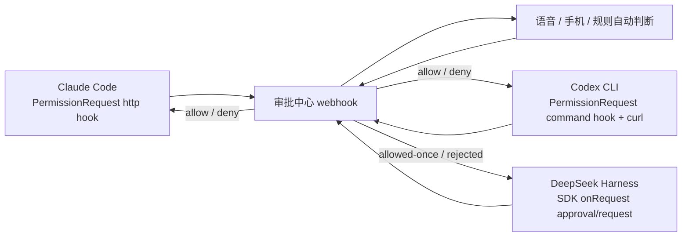

# 用一个 webhook 审批中心统一 DeepSeek Harness、Claude Code 和 Codex（OpenAI）的权限审批

> 整理自 2026-11-18 晚上的语音通话调研，由 DaDa 整理。
> 目标：用 Grok Bot 的语音当入口，把三个 coding agent 弹出的 allow/deny 请求都发到同一个审批中心，由程序或语音来批准，不用去点 UI。

## 结论

三个工具都能接进同一个审批中心：

| 工具 | 推荐接法 | 有没有原生 HTTP/webhook |
| --- | --- | --- |
| Claude Code | `PermissionRequest` hook，`type: "http"`，直接 POST 到审批中心 | 有 |
| Codex CLI（OpenAI） | `PermissionRequest` command hook，在脚本里用 curl 发给审批中心再打印决定 | 没有，要用 command hook |
| DeepSeek Harness | SDK 的 `client.onRequest` 处理 `approval/request` | 没有，走 stdio JSON-RPC |

---

## 1. DeepSeek Harness

**接口**
- 命令行：`dsh`。
- SDK：`@deepseek-ai/dsh-sdk-client`。运行时用 `dsh --profile sdk` 启动，走 stdio 上的 JSON-RPC。
- 我在文档里没找到 REST API。

**无界面模式**
- `dsh --profile headless`：跑一个任务就退出。
- `--json`：输出换行分隔的运行事件。
- `--session-id`：接着一个已有会话继续跑。
- `--permission-mode`：选预设，比如 `workspace-write`、`danger-full-access`。
- `--approval-policy ask|never`。
- `--add-dir`：额外允许访问的目录。

**审批流程**
- 创建 harness 时设 `approvalRequests: true`。
- 调 `client.start()`，再用 `client.onRequest` 注册处理函数，处理方法 `approval/request`。
- 处理函数返回 `allowed-once`、`rejected` 或 `cancelled`。
- 没注册处理函数时默认拒绝（fail closed）。

**插件方式**
- 插件可以挂在 `tools/pre-execute` hook 上：返回 `kind: deny` 加原因就拒绝，调用 `next` 就放行。
- 社区插件 `dsh-permission-rules`（PerryLink）支持用 YAML 写 allow、deny、ask 规则。
- 它没有自带 webhook，但可以在 pre-execute 插件或 SDK 处理函数里 POST 到你的审批中心，然后等它的回复。

**建议**：需要交互式审批时用 SDK 审批处理函数；完全无人值守的任务用 headless 加 `--approval-policy never`。

文档：[DeepSeek SDK client README](https://github.com/deepseek-ai/deepseek-harness/blob/master/packages/sdk/client/README.md)

---

## 2. Claude Code（Anthropic）

**Hook 事件**：`PreToolUse`、`PostToolUse`、`PostToolUseFailure`、`PermissionRequest`、`PermissionDenied`、`Notification` 等。
- `PreToolUse`：每次调用工具前都会触发，可以返回 `allow`、`deny`、`ask` 或 `defer`。
- `PermissionRequest`：只在 Claude Code 准备问你的时候触发，可以返回 `allow` 或 `deny`。**这就是对应审批中心的那个 hook。**

**Webhook（HTTP hook）**
- 每个 hook 处理器都有一个 type：`command`、`http`、`mcp_tool`、`prompt` 或 `agent`。
- `type: "http"` 需要填 `url`，可选 `headers` 和 `allowedEnvVars`（用来放认证 token）。
- Claude Code 把事件 JSON 作为请求体 POST 过去，默认最多等 600 秒；`onFailure` 可以设成 `continue` 或 `block`。

**请求和回复格式**
- 请求里有 `tool_name`、`tool_input`、`permission_mode`、`permission_suggestions`。
- 回复格式：

```json
{
  "hookSpecificOutput": {
    "hookEventName": "PermissionRequest",
    "decision": { "behavior": "allow" }
  }
}
```

- deny 可以带 `message`；allow 可以带 `updatedInput` 或 `updatedPermissions`。
- 这个事件会忽略 exit code 2；hook 也推翻不了你自己设的 deny 规则。没有返回决定时，正常弹窗照样会出现。

**SDK 和 CLI**
- Agent SDK 有 `canUseTool` 回调，在 hook 之后执行，决定 hook 还没定下来的请求。
- TypeScript 选项 `permissionPrompts: 'none'`：把决定完全交给 `PermissionRequest` hook。
- CLI 参数 `--permission-prompt-tool`：把权限请求转给一个 MCP 工具来处理。
- `Notification` hook 的 `permission_prompt` 事件在等待大约 6 秒后触发，适合只发个提醒。

**建议**：在 `settings.json` 里配一个 `type: "http"` 的 `PermissionRequest` hook，指向审批中心。

示例（`settings.json`）：

```json
{
  "hooks": {
    "PermissionRequest": [
      {
        "hooks": [
          {
            "type": "http",
            "url": "https://your-hub.example/approve",
            "headers": { "Authorization": "Bearer $HUB_TOKEN" },
            "allowedEnvVars": ["HUB_TOKEN"]
          }
        ]
      }
    ]
  }
}
```

文档：[Claude Code hooks](https://code.claude.com/docs/en/hooks)

---

## 3. Codex CLI（OpenAI）

**Hook 事件**：`PreToolUse`、`PostToolUse`、`PermissionRequest`。
- `PreToolUse`：能看到 shell、`apply_patch`、MCP 工具和其他本地工具；能拦截或改写调用，但不能批准。
- `PermissionRequest`：只在 Codex 准备请求审批时触发，比如 shell 提权或访问网络；不需要审批的命令不会触发。
- matcher 可以写 `Bash`、`apply_patch`、`Edit`、`Write`，或者 `mcp__server__tool` 这样的 MCP 工具名。

**请求和回复格式**
- 输入有 `tool_name`、`tool_input`、`turn_id`，有时还有 `tool_input.description`。
- 回复格式和 Claude Code 一样：`hookSpecificOutput.hookEventName = "PermissionRequest"`，`decision.behavior = allow | deny`，deny 可以带 message。
- exit code 2 加 stderr 里写原因，也算 deny。多个 hook 同时回答时，只要有一个 deny 就是 deny；都没回答就正常弹窗。

**Webhook**
- 我没查到 http 类型的 hook，要用 command hook：脚本里用 curl 发给审批中心，等它返回决定，再把 JSON 打印出来。
- 想写一个完整程序的话，可以用 app-server：它会发 JSON-RPC 请求 `item/commandExecution/requestApproval`，带 `itemId`、`parsedCmd`、`reason`、`threadId`、`turnId`，由你的客户端回复 approve 或 decline。这只对用 `turn/start` API 开启的回合有效。

**CLI 参数和配置**
- `-a` / `--ask-for-approval`：模式有 `untrusted`、`on-request`、`never`。
- `--sandbox`、`codex exec`（非交互运行）、`--dangerously-bypass-approvals-and-sandbox`。
- `config.toml` 里的 `approval_policy` 等同于命令行参数。

示例 command hook 脚本：

```bash
#!/usr/bin/env bash
# 从 stdin 读事件，发给审批中心，把它返回的决定原样打印出来
curl -sS -X POST "$HUB_URL/approve" \
  -H "Authorization: Bearer $HUB_TOKEN" \
  -H "Content-Type: application/json" \
  --data-binary @- --max-time 600
```

文档：[Codex hooks](https://learn.chatgpt.com/docs/hooks)

---

## 4. 审批中心的整体流程



注意事项：
- 审批中心要在超时之前回复（Claude Code 默认 600 秒），超时的处理方式要和各工具的 fail-closed 或 `onFailure` 设置配合好。
- 认证 token 放在环境变量里，不要写进配置文件。
- 三家的回复格式不同：Claude Code 和 Codex 用 `allow`/`deny`，DeepSeek 用 `allowed-once`/`rejected`/`cancelled`，审批中心要分别转换。
